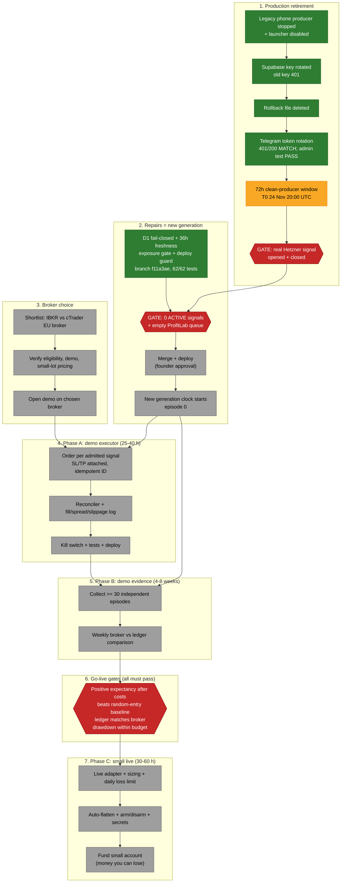

# BotA Execution & Go-Live Roadmap

- Last updated: 2026-11-28 (ChatGPT, execution evidence reconciliation)
- Purpose: single source of truth for where BotA is. Any AI session (Claude or ChatGPT) reads THIS file first instead of re-reading long continuity docs.
- Update rule: when a step changes status, update the Mermaid class, status table row and one changelog line in the same docs-only commit. Keep GitHub main and the Obsidian copy byte-identical; verify SHA-256 after each accepted update. Notify the founder whenever a step or chapter finishes. No production, merge or deploy changes without explicit founder approval.
- Detail: `docs/plans/2026-11-28-execution-layer-plan.md`

Legend: green = DONE, amber = IN PROGRESS / NEXT, grey = PENDING, red = GATE (must pass before continuing)

## Status table

| # | Step | Status | Evidence / note |
|---|---|---|---|
| 1.1 | Legacy phone producer stopped + launcher disabled | DONE | 24 Nov; reboot persistence PASS |
| 1.2 | Supabase key rotated (bota_hetzner), old key revoked | DONE | 401 test 24 Nov 19:59:56 UTC |
| 1.3 | Supabase rollback file deleted | DONE | 25 Nov, guarded shred PASS |
| 1.4 | Telegram token rotation | DONE | Founder-reported execution 28 Nov: old getMe HTTP 401 at 14:09:00 UTC; new getMe HTTP 200 MATCH at 14:09:03 UTC. Replacement installed on Hetzner; ProfitLab Account / Admin Actions / Send Telegram Test: founder confirmed message received on 28 Nov (PASS; exact delivery timestamp not supplied). Consumers: Hetzner + phone (old fingerprint 7e18d1067664); scanner and send-telegram excluded. |
| 1.5 | 72h clean-producer window | IN PROGRESS | Earliest end 27 Nov 20:00 UTC has passed; extends until gate 1.6. Full clean-producer verification not re-audited in this session. |
| 1.6 | GATE: real Hetzner signal opened + closed | PENDING | Read-only Supabase signals query 28 Nov: 0 opened since T0 24 Nov 20:00 UTC, 0 opened and closed since T0; latest creation 23 Nov 16:30:04.819262 UTC, latest closure 23 Nov 19:15 UTC. Do not manufacture signals. |
| 2.1 | Repairs implemented (D1, exposure gate, deploy guard) | DONE | Branch fix/retirement-d1-active-signal-tests-20261125 @ f11a3ae; 62/62 tests independently verified |
| 2.2 | GATE: 0 ACTIVE + empty ProfitLab queue | PENDING | Checked at deploy time |
| 2.3 | Merge + deploy | PENDING | Founder approval required |
| 2.4 | New generation clock | PENDING | Later of 1.6 and 2.3 |
| 3.x | Broker choice (IBKR vs cTrader EU) | PENDING | Founder decision |
| 4.x | Phase A demo executor | PENDING | Starts after 2.4 and 3.x |
| 5.x | Phase B demo evidence | PENDING | >= 30 episodes |
| 6 | Go-live gates | PENDING | Pre-registered, all must pass |
| 7.x | Phase C small live | PENDING | Only after 6 |

## Changelog

- 2026-11-28: roadmap created (Claude).
- 2026-11-28: recorded Telegram getMe 401/200 MATCH evidence (admin test pending), verified no post-T0 signal lifecycle, retained R4/R5 active and R6 gate; added roadmap-first pointers to continuity files.
- 2026-11-28: step 1.4 DONE after founder confirmed receipt of the Telegram admin test; moved R4 to done; 1.5 and 1.6 unchanged.
